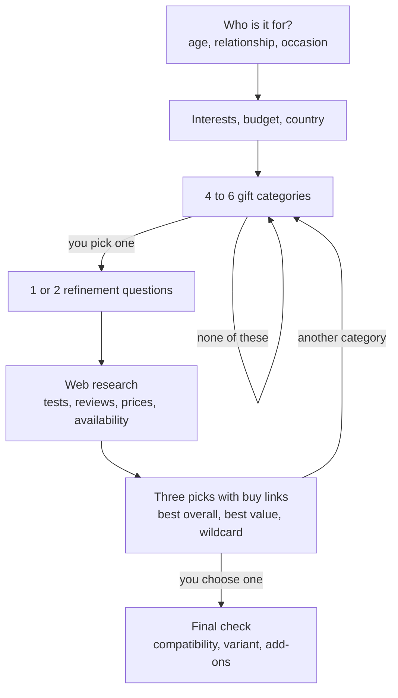

# Gift Finder

An agent skill that finds well-researched gifts for the people you care about, or for yourself.

It asks a few short questions, proposes a handful of gift categories, and then researches the category you choose in depth. You end up with three concrete products, each with a price, a reason it fits, an honest trade-off and a direct link to buy it.

Works with Claude (claude.ai, Claude Code) and any agent that supports the open `SKILL.md` format.

## How it works



1. **Who is it for.** Age, relationship, occasion. Anything you already said is not asked again.
2. **Interests and budget.** Pick from broad interest types or type your own, then give a budget and the country it ships to.
3. **Category ideas.** Four to six concrete gift types, each with a one-line reason.
4. **Refine.** One or two questions that change which product is best, for example how far someone runs before choosing a running belt.
5. **Research.** Independent tests and reviews, cross-checked, with current prices from shops that deliver to you.
6. **Three picks.** Best overall, best value and a wildcard, each with a direct buy link on Amazon or another shop that delivers to your country.
7. **Finalise.** Choose one and it checks the details that matter on the day: compatibility with what the person already owns, colour or size, and anything missing from the box, such as film for a photo printer.

## Example

> **You:** /gift-finder my brother, 30, runs a lot and reads comics. Around 50 euros, we're in Luxembourg.
>
> **Agent:** Here are five directions that fit him:
> 1. Running belt: carries phone and keys on the runs he already does
> 2. Graphic novel box set: a complete story arc rather than a single volume
> 3. Recovery tool: useful after every run, rarely bought for oneself
> 4. Premium running socks: the safe choice
> 5. Framed comic art print: something for his wall
>
> Which one should I research?
>
> **You:** The running belt.
>
> **Agent:** Two quick things: how far does he usually run, and does it need to hold a large phone or water?
>
> **You:** 10 to 15 km, big phone, no water.
>
> **Agent:** *(researches, then returns three belts with prices, reasons, trade-offs, links and sources)*

## Install

### Claude Code (plugin)

```
/plugin marketplace add toxx663/gift-finder
/plugin install gift-finder@toxx663-skills
```

### Any agent, via the skills CLI

```bash
npx skills add toxx663/gift-finder
```

### Claude apps (claude.ai, desktop, mobile)

1. Download `gift-finder.zip` from the [latest release](https://github.com/toxx663/gift-finder/releases/latest).
2. In Claude, open your skills settings and upload the zip.

### Manual

```bash
git clone https://github.com/toxx663/gift-finder.git
cp -r gift-finder/skills/gift-finder ~/.claude/skills/
```

## Usage

Run the command, with or without details:

```
/gift-finder
/gift-finder birthday present for my mum, 62, loves gardening, up to 80 euros
```

Or just ask naturally: "What should I get my colleague for her leaving do?" The skill triggers on gift requests without the command.

## Requirements

- An agent that supports `SKILL.md` skills.
- **Web search**, for the research step. Without it the skill still works, but it tells you that prices and availability are unverified.

No API keys, no scripts, no dependencies. The skill is a single Markdown file.

## What it will not do

- Invent products, prices, ratings or links.
- Use affiliate links or tracking tags. Buy links go to the plain product page.
- Recommend beyond your budget without saying so.

## Privacy

The skill stores nothing and sends nothing anywhere by itself. What you tell it about the recipient stays in your conversation with your agent, under that agent's own privacy terms.

## Contributing

Ideas and fixes are welcome. See [CONTRIBUTING.md](CONTRIBUTING.md).

## License

[MIT](LICENSE)
